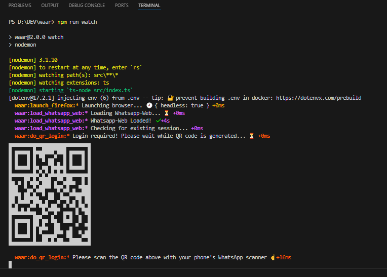
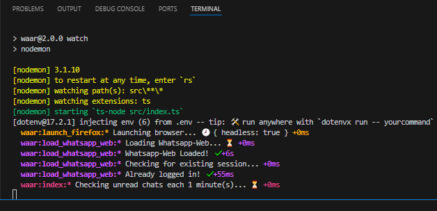

> # ⚠️ UNMAINTAINED / DEPRECATED — do not use
>
> **This project is no longer maintained and its use is discouraged.**
>
> The repository is **archived** (read-only): issues and pull requests are closed,
> no further releases will be published, and **security alerts are not being
> monitored or acted upon**. Known vulnerabilities in its dependency tree — including
> a high-severity advisory in `js-yaml` reachable through the committed
> `package-lock.json` — will **not** be fixed.
>
> This applies to the published npm package as well: **do not run `npx waar`** and do
> not add it as a dependency. If you already do, remove it.
>
> If you need the functionality, fork the code and audit/update the dependencies
> yourself — you take on full responsibility for doing so.
>
> The content below is kept for historical reference only.

<div style="display: flex; justify-content: space-between;">
  
  
  
</div>

# 🤖💬 waar | WhatsApp Auto-Reply

- Runs headless: No browser UI window displayed. (You can change this later with `HEADLESS` env variable) 
- Keeps session stored for next uses: Scan QR directly from terminal and only once





## ✨ Usage

- `npx waar` (easiest way, no clone required)

## 💻 Shell Installation

> **Requires Git, NodeJS and npm** installed in your system

- `git clone https://github.com/yeikiu/waar`
- `cd waar`
- `npm i` (install dependencies once)

- `npm run start` / `npm run watch` (dev mode)

## 🔧 .env config

```
# Use `HEADLESS=false` if you want to see the browser window while running
HEADLESS=true

# The auto-reply message sent to contacts (groups are ignored by default)
WAAR_DEFAULT_MESSAGE='En estos momentos no puedo responder WhatsApps. 🙏🏼\n\nTe escribo pronto! 🤓'

# Time interval to check for new chats under the `Unread` tab
MINUTES_BETWEEN_UNREAD_CHECKS=1

# Time interval to skip auto-replies after last one ocurred for a contact (avoids spamming)
MIN_MINUTES_BETWEEN_REPLIES=180
```

## 📝 Development

- `npm run watch`
